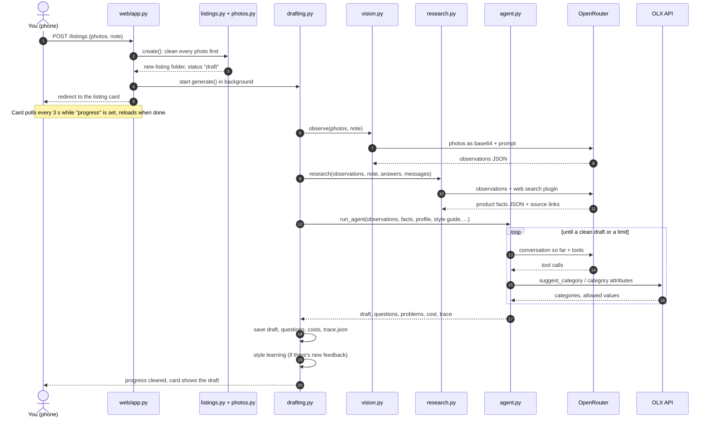
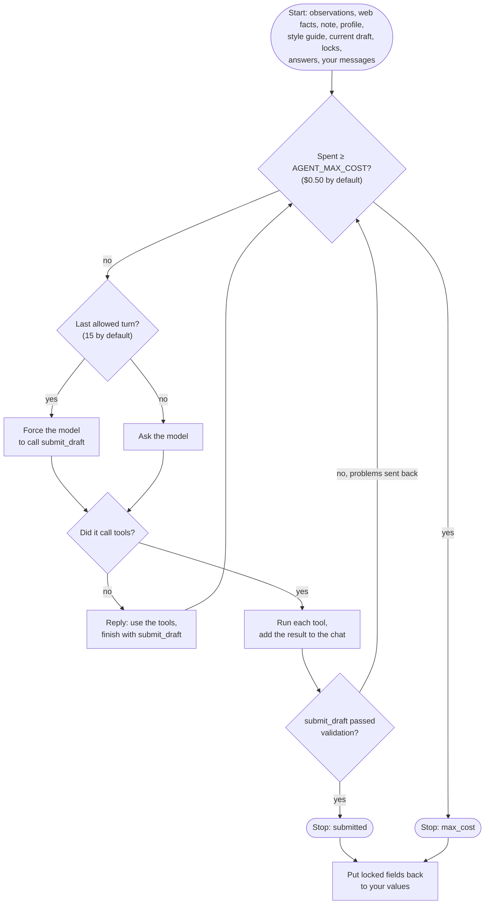
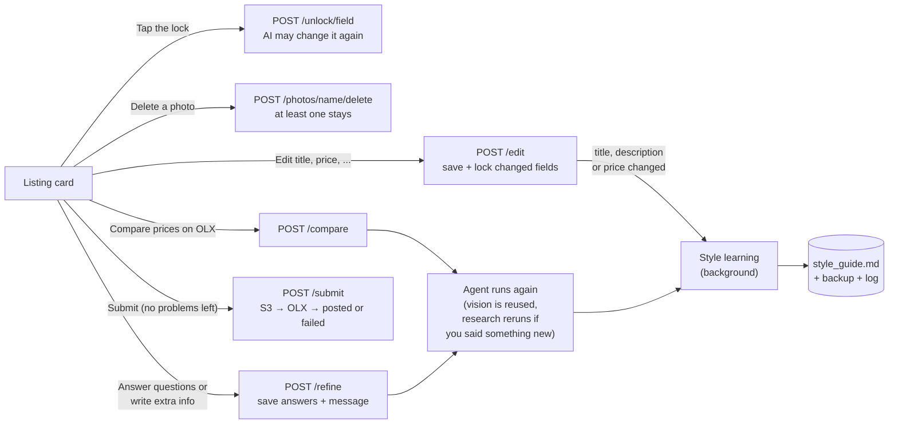
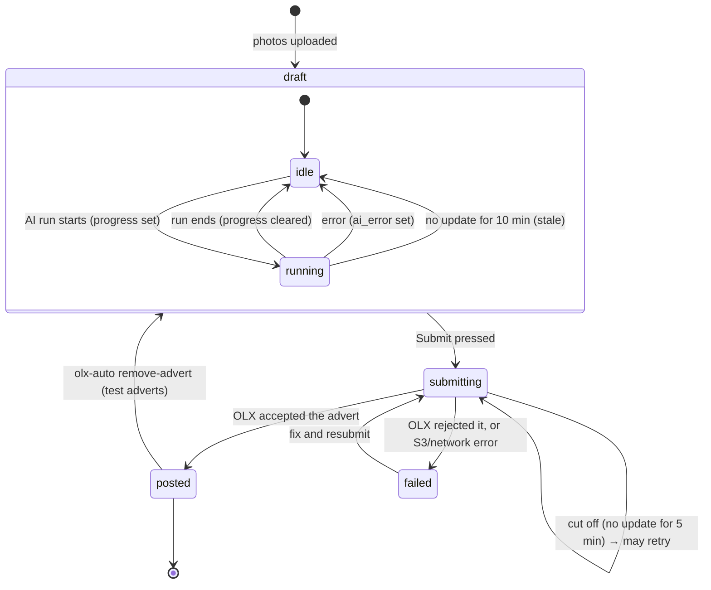

# How olx-auto works

A plain-language tour of the app with diagrams, for reading before the code. You take a few photos of something you want to sell. Two AI models look at them, pick an OLX category, write a Bulgarian title and description, and suggest a price in EUR. You check the result on the listing card, fix what's wrong, and press Submit to post it on olx.bg.

For the exact details, see [ARCHITECTURE.md](ARCHITECTURE.md) (code, data, flows) and [SPEC.md](SPEC.md) (scope, decisions, progress in §12).

## 1. The big picture

```mermaid
flowchart LR
  phone["Your phone<br/>photos + short note"] -->|upload| clean["Clean the photos<br/>rotate, shrink, remove GPS"]
  clean --> disk[("data/ folder<br/>listing.json + JPEGs")]
  clean -. "starts in background" .-> vision["Stage 1: Vision AI<br/>describes what it sees"]
  vision --> research["Stage 1b: Research AI<br/>looks the product up on the web"]
  research --> agent["Stage 2: Agent AI<br/>category, text, price"]
  agent --> card["Listing card<br/>you review and edit"]
  card -->|"answers, extra info"| agent
  card -->|"your text edits"| style["Style learning<br/>updates your style guide"]
  style -. "used next time" .-> agent
  card -->|Submit| submit["Submit<br/>photos via S3, post to olx.bg"]
```

Solid arrows exist today. Dotted arrows are background work.

Three ideas make the design easy to follow:

- **Everything is a file.** There is no database. Each listing is a folder with a `listing.json` file and its photos. You can open these files in any text editor.
- **The AI never blocks you.** It always produces a best-guess draft. If it's unsure, it adds questions to the card, and answering them reruns the AI.
- **Separate AI stages, on purpose.** Photos are expensive to send to an AI. So a cheap "vision" model looks at them once and writes a text description. Another cheap model then searches the web for that product (model, sizes, specs) and writes down the facts. The smarter "agent" model works only from that text.

## 2. The modules

Every Python file in `src/olx_auto/` and what it's responsible for. A "module" in Python is just one `.py` file.

| Group | Module | What it does |
|---|---|---|
| Entry points | `web/app.py` | The website. Every URL (login, home, new listing, listing card, profile, style guide, Connect OLX) is a function here. Built with FastAPI; the HTML lives in `web/templates/`. |
| | `cli.py` | The `olx-auto` terminal command: `serve`, `add-user`, `set-password`, `login`, `check`, `draft`, `remove-advert` (takes a test advert off OLX). |
| Conductor | `drafting.py` | Runs one AI pass on a listing: vision (only the first time), research (when there's something new to look up), then the agent, then style learning. Writes progress, costs and the trace to disk as it goes, so you can close your phone and come back. |
| | `submitting.py` | Posts a listing to OLX: photos to S3, create the advert, delete the S3 copies, save `posted` or `failed` with OLX's reasons. Also refreshes a posted advert's OLX status and removes test adverts. |
| AI | `vision.py` | Stage 1. Sends the photos to the vision model and gets back "observations": item type, brand, model, text on the item, condition, defects, accessories, open questions. |
| | `research.py` | Stage 1b. One call to a small model with OpenRouter's web search turned on (the search engine is the `SEARCH_ENGINE` setting; the search fee costs more than the model). It identifies the exact product and returns its facts (specs, features, variants, new price) with the pages it used. |
| | `agent.py` | Stage 2. The hand-written tool loop. Gives the agent model five tools and lets it call them until it submits a draft that passes the checks. Holds the system prompt. |
| | `style.py` | The Bulgarian style guide: reading, saving with backups, a change log, Undo, and the "learner" AI call that turns your feedback into general rules. |
| | `llm.py` | The one place that talks to OpenRouter. Returns the model's reply plus token counts and cost in USD. |
| Rules | `validation.py` | Checks a draft: title 16–150 chars, description 40–9000, no phone numbers / emails / links, not too many capitals, valid attribute codes. Plus the extra checks before Submit (photos, location, contact name). |
| | `adverts.py` | Turns a listing + profile into the JSON that OLX's `POST /adverts` expects. `submitting.py` calls it. |
| Storage | `users.py` | App users: one folder each, password hashing (scrypt), login check. The `User` object knows the paths to all of that user's files. |
| | `listings.py` | Create, load, save and list listings; delete a photo (never the last one). Records hand edits and locks edited fields. Knows whether an AI run is still going. |
| | `profiles.py` | `profile.json`: contact name/phone/email, city and district, private or business, courier delivery. Validates the profile form. |
| | `photos.py` | Cleans each uploaded photo: opens JPEG/PNG/HEIC, turns it upright, shrinks it to 2000 px, saves it as JPEG without metadata (so no GPS location leaks). |
| Plumbing | `config.py` | Reads `.env` and environment variables into one `Settings` object: API keys, model names, cost limits, the data folder. |
| | `comparables.py` | Reads the public olx.bg search page (as a browser would) and pulls out the asking prices of similar adverts. Fragile by nature, so it's kept apart; if OLX changes the page, the agent just prices without it. |
| | `s3.py` | The private S3 bucket: upload a photo and get a short-lived link OLX can download it from, then delete it. |
| | `olx.py` | The OLX API client, standard library only. Handles tokens (and their automatic renewal) and has a method for each OLX endpoint. |

## 3. Who uses whom

An arrow from A to B means "A imports B and calls it". Higher layers call lower ones, never the other way round.

```mermaid
flowchart TB
  subgraph entry["Entry points"]
    app["web/app.py"]
    cli["cli.py"]
  end
  subgraph orchestration["Conductor"]
    drafting["drafting.py"]
    submitting["submitting.py"]
  end
  subgraph ai["AI"]
    agent["agent.py"]
    vision["vision.py"]
    research["research.py"]
    style["style.py"]
    llm["llm.py"]
  end
  subgraph rules["Rules"]
    validation["validation.py"]
    adverts["adverts.py"]
  end
  subgraph storage["Storage"]
    listings["listings.py"]
    profiles["profiles.py"]
    users["users.py"]
    photos["photos.py"]
  end
  subgraph base["Plumbing"]
    config["config.py"]
    olx["olx.py"]
    s3["s3.py"]
    comparables["comparables.py"]
  end
  subgraph outside["Outside world"]
    openrouter(["OpenRouter AI"])
    olxapi(["OLX partner API"])
    aws(["AWS S3"])
    olxweb(["olx.bg search page"])
    pillow(["Pillow image library"])
  end

  cli --> app
  app --> drafting & submitting & listings & profiles & style & users & validation
  cli --> drafting & submitting & listings & users
  submitting --> adverts & validation & listings & profiles & s3 & olx
  drafting --> agent & vision & research & style & listings & profiles
  agent --> vision & validation & llm
  drafting --> comparables
  comparables --> olxweb
  vision --> llm
  research --> llm
  style --> llm
  style --> users
  listings --> photos & users
  profiles --> users
  users --> olx & config
  app --> config
  cli --> config
  drafting --> config
  llm --> openrouter
  olx --> olxapi
  s3 --> aws
  photos --> pillow
```

Left out for readability: imports used only to catch an error type (`OlxError`, `LLMError`, `InvalidPhoto`), and `drafting → llm/users`, which are type hints and setup.

`validation.py` and `adverts.py` import nothing from the app, and `olx.py` uses only the standard library. Small files at the bottom with no dependencies are easy to test and hard to break.

## 4. What happens when you create a listing



1. **Upload is checked before anything is saved.** 1 to 20 photos. Every photo is processed first, so a broken file leaves nothing half-written on disk.
2. **The AI runs in the background.** FastAPI's `BackgroundTasks` runs `drafting.generate` after the page has answered. You see a progress line like "Choosing category…", updated in place: a few lines of JavaScript ask `/listings/{id}/progress` every 3 s and reload the page once when the draft is ready.
3. **Vision runs only once per listing.** Later refinements reuse the saved observations.
4. **Research runs on every listing, but not on every run.** It runs again only when you've added answers or messages since the last lookup (you might have corrected the model). If the lookup fails, the agent carries on without it.
5. **Errors never crash the run.** Any AI or OLX error ends up in the listing's `ai_error` field and is shown on the card.
6. **Everything is logged.** Each run appends to `trace.json`: every message, tool call, token count and cost. Set `SHOW_TRACE=true` to see it on the card.

## 5. Inside the agent loop

The "agent" is a loop in `agent.py`: ask the model what to do, run the tool it picked, give it the result, repeat.



| Tool | What it does | Talks to |
|---|---|---|
| `look_at_photos` | Asks the vision model a specific question, e.g. "Is the screen cracked?" | OpenRouter |
| `suggest_category` | Gets OLX category suggestions for a short search like "детска количка". | OLX API |
| `get_category_attributes` | Lists the fields a category needs (condition, size…) and their allowed values. Refuses non-leaf categories and ones OLX won't take from the API. | OLX API |
| `search_olx_comparables` | Looks up what similar items are listed at on olx.bg right now: titles, prices, the median. Offered only in a run started with **Compare prices on OLX**; at most 3 searches. | olx.bg search page |
| `ask_user` | Adds questions to the card. Doesn't wait for answers. | nothing |
| `submit_draft` | Hands in the listing and runs `validation.check_draft`. Problems go back to the model so it can fix them. | `validation.py` |

**Locks are enforced by code, not trust.** The prompt asks the model to keep locked fields, and `_apply_locks` also overwrites them with your values after every run. Even if the model ignores the instruction, your edit survives.

## 6. The listing card

The review page at `/listings/{id}` has five ways to change a draft, and Submit.



- **Prices are compared with OLX only when you ask.** Compare prices on OLX runs the agent with the olx.bg search; other runs don't go online for prices. The last comparison stays on the card and is given to every later run, so the price doesn't drift away from it.
- **Messages are kept forever.** What you write in the "additional information" box is stored on the listing and given to every later run, so a fact mentioned once isn't lost.
- **The card is frozen while the AI runs.** Forms are disabled and the POST routes do nothing until the run ends. If the server restarted mid-run, the card unfreezes after 10 minutes.
- **"To fix before submitting"** is computed on every page load, because the profile can change at any time. The Submit button stays disabled until the list is empty.
- **Once posted, the card is read-only** and shows OLX's status and a link to the advert. A failed submit shows OLX's reasons next to the field names; fix them and submit again.
- **Style learning** looks only at feedback it hasn't seen yet. It keeps general preferences ("don't write ПРОДАВАМ") and ignores facts about this one item. Every change is backed up and can be undone on the Style page.

## 7. Listing states

The `status` field in `listing.json`, plus the "AI is running" sub-state.



A posted listing can't be edited any more. An advert OLX accepted isn't live yet, so the card and the home page show OLX's own status instead of "posted", refreshed at most once a minute per advert when you open the home page or the card:

| OLX status | Shown as | Meaning |
|---|---|---|
| `new`, `disabled` | pending moderation | OLX hasn't approved it yet. |
| `active` | live | Buyers can see it. |
| `limited` | needs payment | The free quota for this category is used up. Pay in the OLX app. |
| `moderated`, `blocked` | rejected by OLX | OLX refused it. |
| gone (404) | deleted | The advert no longer exists on OLX. |

## 8. Data on disk

Everything lives under `data/`, which is never committed to git.

```
data/
  .session_secret                 signs login cookies (made on first run)
  users/ico-test/                 one folder per app user (only you can read it)
    user.json                     display name + password hash
    profile.json                  contact, city/district, private/business, courier
    style_guide.md                how your listings should read (Bulgarian)
    style_guide_history/          old versions, one file per change
    style_guide_log.json          what changed, why, from which listing
    olx_token.json                OLX tokens (secret, chmod 600)
    listings/20261123-101500-a3f9/
      listing.json                the listing itself (see below)
      photos/01.jpg, 02.jpg …     cleaned photos
      trace.json                  full log of every AI run
```

The important fields in `listing.json`:

| Field | What it holds |
|---|---|
| `status` | `draft`, `submitting`, `posted` or `failed`. |
| `note`, `photos` | What you uploaded. |
| `observations` | What the vision model saw. Computed once. |
| `research`, `research_seen` | Product facts found on the web, with source links, and how many of your messages and answers the lookup had seen. |
| `category` | The chosen OLX category with its attribute rules and photo limit. |
| `draft` | The current listing: title, description, category, attributes, price, negotiable, price estimate and reasoning. |
| `ai_draft` | The draft exactly as the AI last wrote it, before your edits. |
| `locked` | Fields you edited by hand. The AI must keep them. |
| `questions` | The AI's questions to you, with your answers. |
| `messages` | Your extra info and change requests, oldest first. |
| `edits` | History of hand edits (before → after). Feeds style learning. |
| `learned` | How many messages and edits style learning has already used. |
| `progress` | Set while an AI run is going ("Reading photos…"); empty otherwise. |
| `ai_error` | The last AI or OLX error from drafting, if any. |
| `olx` | After a successful Submit: the advert's id, link, OLX status and OLX image links. |
| `error` | Why the last Submit failed: a message and OLX's complaints per field. |
| `cost` | USD spent on this listing, split into vision, research, agent and style. |

**Safe writes.** Files are written to a temporary file and then renamed over the real one (`os.replace`). A rename is all-or-nothing, so a crash never leaves a half-written file. The OLX token file also re-reads itself under a lock before every save, so a rotated refresh token is never overwritten by an older copy.

## 9. Outside services and libraries

| Service | Used for | Code |
|---|---|---|
| olx.bg search page | Prices of similar adverts (the partner API can't search other people's adverts). | `comparables.py` |
| OpenRouter | One account that reaches many AI models. Defaults are in `config.py` (`VISION_MODEL`, `RESEARCH_MODEL`, `AGENT_MODEL`). Research uses its web search plugin. | `llm.py` |
| OLX partner API | Categories, attributes, locations, the connected account, and creating adverts. No sandbox: a real POST publishes a real ad. | `olx.py` |
| AWS S3 | Temporary home for photos during Submit. OLX copies them, then they're deleted. | `s3.py`, `infra/s3-setup.sh` |
| Tailscale Funnel | Puts the app on the Mac on the public internet over HTTPS at its `ts.net` address. The login (with a lockout after 10 wrong passwords) is what keeps strangers out. | outside the code |

| Package | Why it's here |
|---|---|
| `fastapi` | The web framework: turns functions into URLs. |
| `uvicorn` | The web server that runs the FastAPI app. |
| `jinja2` | HTML templates with `{{ placeholders }}`. |
| `python-multipart` | Lets FastAPI read form posts and file uploads. |
| `itsdangerous` | Signs the login cookie so it can't be forged. |
| `openai` | The SDK used to call OpenRouter (it speaks the same protocol). |
| `pillow`, `pillow-heif` | Image processing, including iPhone HEIC photos. |
| `boto3` | Amazon's SDK, for the S3 photo bucket. |
| `pytest`, `ruff`, `httpx2` | Dev only: tests, linting, the test HTTP client. |

## 10. Safety rules built into the code

- **Users can't see each other.** Every page gets the logged-in `User` and reaches files only through it. Any id from a URL must match a strict pattern (`NAME_RE`, `ID_RE`, `PHOTO_RE`) or the answer is a 404. That also blocks tricks like `../../`.
- **Passwords** are stored as scrypt hashes. A wrong password waits 1 second, and an unknown user name takes as long as a known one.
- **No GPS in photos.** Re-saving each photo without metadata removes the location the phone recorded.
- **The AI never sees contact details.** Name, phone and email are removed from the profile before the agent sees it. Code adds them to the OLX payload at Submit.
- **Spending limits.** Each agent run stops at `AGENT_MAX_COST` or `AGENT_MAX_ITERATIONS`, keeping the best draft so far.
- **No double posts.** Submit saves `submitting` before it talks to OLX, so a second tap is refused. If OLX doesn't answer, the card says to check OLX before trying again.
- **Tests stay offline.** OLX and the AI are replaced with fakes in tests. No test can post a real advert or spend money.

## 11. Python patterns you'll see

| Pattern | Meaning |
|---|---|
| `@dataclass` | A class that's just a bundle of named fields: `Settings`, `User`, `Reply`, `AgentInput`, `AgentResult`. `frozen=True` means the values can't change after creation. |
| `dict` | Python's key → value map, the same shape as JSON. A listing is a `dict` in memory and a `.json` file on disk. |
| `x: str \| None` | A type hint: a note about what a value is. Python doesn't enforce it. `\| None` means "or nothing". |
| `Protocol` | `agent.Catalog` says "anything with these three methods will do". The real `Olx` client fits, and so does the fake one in tests. |
| `@app.get("/path")` | A decorator: the function below runs when someone opens that URL. `CurrentUser` in the arguments makes FastAPI check the login first. |
| `try` / `except` | Catch an error and handle it instead of crashing. `drafting.generate` catches AI and OLX errors and saves them as `ai_error`. |
| `with _learn_lock:` | Only one thread at a time may run the code inside. Used so two style updates can't overwrite each other. |
| `{**a, **b}` | "Spread these key/value pairs": start with `a`, then overwrite with `b`. |

```sh
uv run olx-auto serve                           # start the app on http://127.0.0.1:8000
uv run olx-auto draft ico-test <id> -m "по-евтино"   # rerun the AI on a listing
uv run ruff check . && uv run pytest -q          # the "done" check from CLAUDE.md
```

## 12. Known limits and open questions

- **Token lock is per process.** The CLI and the web server renewing the OLX token at the same instant could still collide.
- **An expired OLX connection isn't flagged up front.** The home page only warns when no account was ever connected. If the token has died (about a month unused), Submit fails with an error and the OLX page says the connection is broken. Reconnect there.
- **The app is on the public internet** (Tailscale Funnel). Only the passwords protect it, with a 15-minute lockout after 10 wrong ones per user name.
- **Deleting a photo doesn't redo vision.** Observations may still mention a deleted photo by number.
- **Web facts can be wrong.** The research model may pick the wrong variant or a bad source. It reports a confidence, the agent shouldn't state low-confidence specs, and the card shows the facts with their sources so you can check them.
- **Comparables can break without warning.** They come from olx.bg's web page, not an API. If OLX changes the page or blocks the requests, the comparing run carries on without them and the trace shows the error.
- **Comparables are asking prices**, not sale prices, and a broad category mixes different items. The agent judges by title; whether that's good enough still needs real runs.
